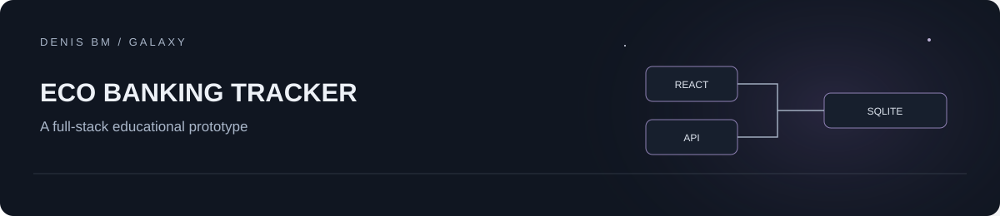

# Eco Banking Tracker

An educational full-stack finance dashboard: account registration, simulated cards and transactions, category analytics, challenges and illustrative environmental estimates.

**React + TypeScript + Express + SQLite.** This is a portfolio prototype, with no banking integration or real payments. Carbon factors, rewards and certificates are demonstration logic, not verified environmental accounting.

## Project context

This is a personal educational project assembled with substantial AI assistance. It is a portfolio demo for studying application structure and integrations, with the original source notices and dependency attribution retained.

## Run locally

Use Node.js 22 LTS, pnpm 11 and a local development environment. SQLite uses a native module; allow its trusted package build if your package manager requests it.

```sh
pnpm install --frozen-lockfile
# Copy .env.example to .env; set a random JWT_SECRET (32+ characters).
# Generate one locally with:
node -e "console.log(require('node:crypto').randomBytes(48).toString('hex'))"
pnpm dev
```

Open `http://127.0.0.1:3000`. Register a fresh test account. A new local SQLite database is created automatically. Use fictional data only.

`GEMINI_API_KEY` is optional: without it, category tips use the local fallback. When enabled, the server sends category/spend summaries to Google's API; do not use real financial data in this demo. Keys belong in the server environment, never frontend code or Git.

```sh
pnpm lint
pnpm build
pnpm start
```

## Structure

| Path | Purpose |
| --- | --- |
| `src/` | Dashboard, cards, analytics and client state |
| `server.ts` | Express API, authentication and optional tip generation |
| `database/` | SQLite schema and data-access models |
| `.env.example` | Empty environment template |

## Scope and release preparation

The provided prototype was cleaned for publication: personal database files, credentials, dependencies and logs are excluded; the JWT signing secret is now required; the development server binds to loopback; an incorrect animation import was fixed. Existing Apache-2.0 source notices are retained.

Type checking, production bundling, server startup and registration/login with a fresh fictional test account pass. This does not establish production readiness. Before hosting for other users, add comprehensive request validation, abuse controls, security review, reliable backups and API integration tests. There is no trained ML model in this repository; optional generated tips are an API integration.

## License

Apache-2.0; see [LICENSE](LICENSE). Dependencies retain their own licenses.
